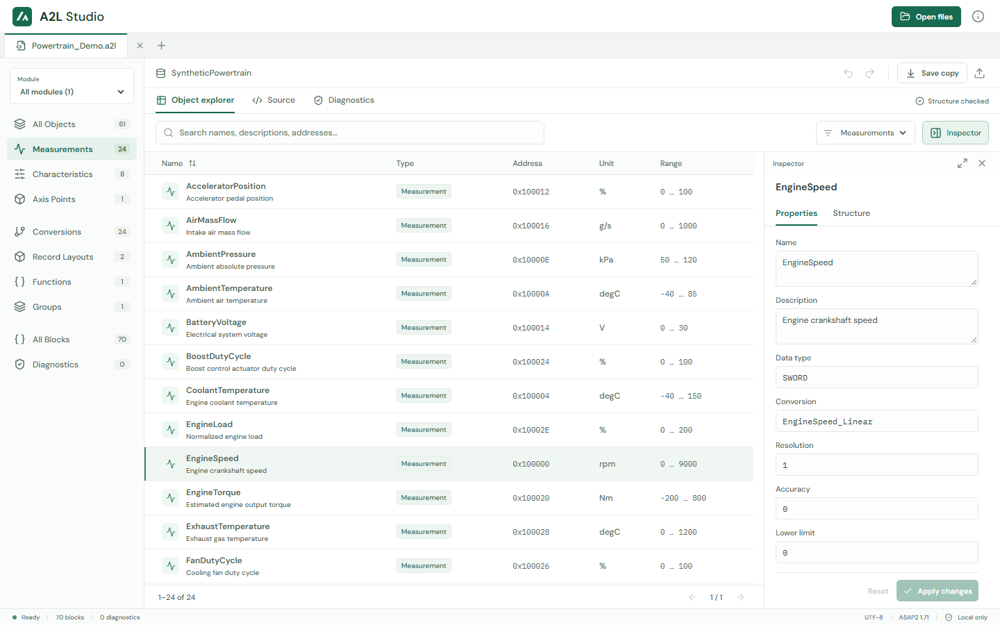
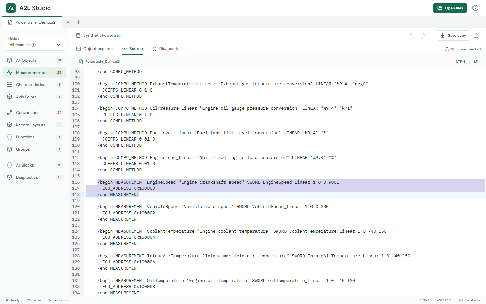
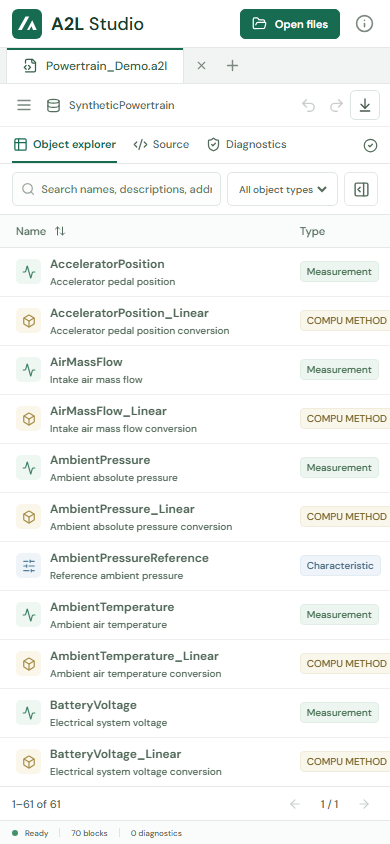
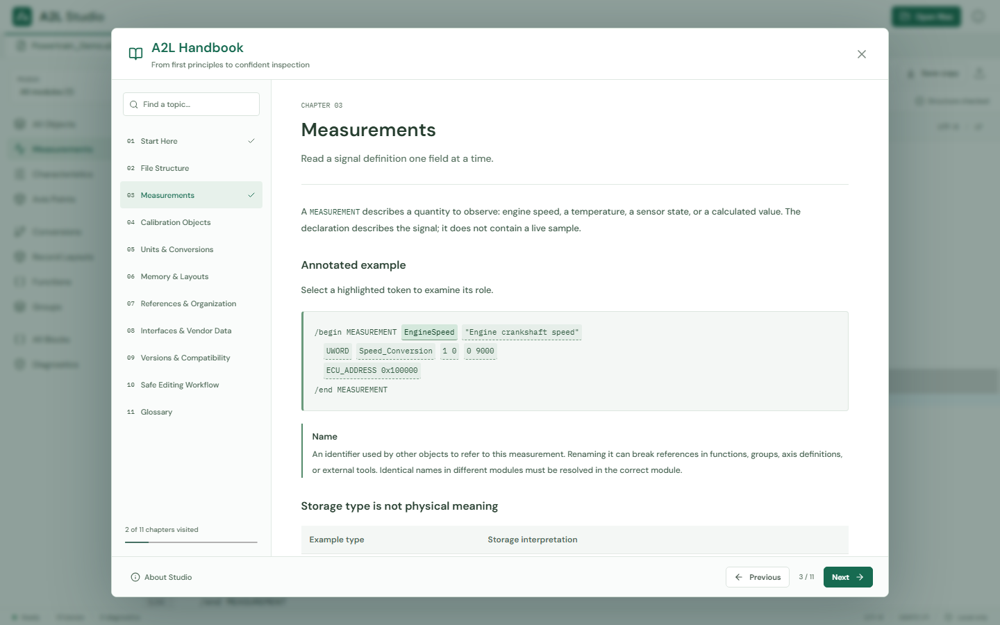

# A2L Studio

A browser-local workbench for inspecting and editing ASAP2/A2L calibration descriptions. The implemented frontend uses React, Vite, TypeScript, Chevrotain, and CodeMirror, with a browser worker for parsing. The application builds to a static site; there is no application backend.



## UI Preview

### Source Navigation

Select an object and choose **Open source** to jump to and highlight its exact block in the complete A2L document.



### Mobile Workspace



### A2L Handbook

The header's **Learn about A2L** info icon opens an illustrated, searchable handbook. Eleven chapters cover first principles, file structure, measurements, calibration objects, conversions, memory layouts, references, interfaces, versions, safe editing, and a glossary. Explore clickable measurement fields and a live linear-conversion calculator with a graph. Chapter navigation and topic search work on desktop and mobile; opening or closing the guide does not change documents.



All preview images show the bundled synthetic demo, not proprietary ECU data.

## Set Up a New PC

These steps apply to Windows (PowerShell), macOS (Terminal), and Linux (a terminal).

1. Install Git and a supported Node.js LTS release **>=22.12**, including npm. Use the official [Git](https://git-scm.com/downloads) and [Node.js](https://nodejs.org/en/download) installers or your organization's approved package manager. On Linux, distribution packages may be older than required. Reopen your terminal after installation.
2. Check the tools:

   ```sh
   git --version
   node --version
   npm --version
   ```

3. Replace `<REPOSITORY_URL>` with the actual repository URL. It is intentionally a placeholder, not a working remote:

   ```sh
   git clone "<REPOSITORY_URL>" a2l_reader
   cd a2l_reader
   npm ci
   ```

   `npm ci` installs the versions in the committed lockfile. Do not delete the lockfile to resolve installation failures.

4. Start the development server:

   ```sh
   npm run dev
   ```

   Open the URL printed by Vite, normally `http://127.0.0.1:5173` (`http://localhost:5173` also works where localhost resolves appropriately). The script binds to loopback, not the network. Vite may select another port if 5173 is occupied. Stop the server with Ctrl+C.

### Windows PowerShell Policy

If PowerShell reports that `npm.ps1` cannot run because of execution policy, invoke the Windows command shim instead:

```powershell
npm.cmd ci
npm.cmd run dev
npm.cmd test
npm.cmd run build
npm.cmd run preview
```

Use `npm.cmd run test:e2e` and `npx.cmd playwright install chromium` for the browser commands below when needed. Do not change execution policy, bypass organizational controls, or run the project as Administrator to work around this issue.

## Studio Workflow

- **Start with the demo:** the app opens a synthetic powertrain document automatically. Its signals, addresses, and values are fictional, not an ECU memory map. The demo can also be opened again from the UI.
- **Open files:** use **Open files** to multi-select up to **12 files at once**, with `.a2l` or `.aml` extensions and a **50 MiB per-file cap**. Drag-and-drop is also supported. Each document has an independent tab, source, category/module/search filters, and undo/redo history.
- **Close a document:** the **X beside the tab strip** closes the active document. A dirty document prompts to keep editing or discard changes; closing a tab does not save it.
- **Browse:** combine category, module, and search filters in the Object explorer. **All blocks** includes nested and unknown vendor blocks, not just recognized object categories. Search operates within the selected scope; the table is paginated.
- **Inspect and edit:** select an object or use the **Inspector** toggle beside the table filters. The toggle indicates whether the panel is open. Close it with the top-right **X** or **Escape**; selection is retained when reopening. On desktop, expand/shrink arrows change the panel width. **Properties** exposes supported fields, **Structure** shows nested blocks, and **Details** contains metadata. Property edits replace exact source tokens while retaining surrounding text. Renaming an object does **not** automatically rewrite references; review related references yourself.
- **Jump to source:** **Open source** in the inspector opens the full source file, highlights the selected block, and scrolls to its start, including in CRLF documents.
- **Edit raw source:** the **Source** view permits arbitrary block and text edits, including content not exposed as property fields. CodeMirror provides C-like highlighting, line numbers, folding, and search; it is **not a full A2L language service**.
- **Review diagnostics:** inspect structural errors and selected warnings, navigate to relevant content, or download a JSON report. A clean report is not proof of semantic correctness.
- **Export:** the compact toolbar provides undo, redo, **Save copy**, and **Export UTF-8 copy**. Save copy preserves the detected encoding and BOM; explicit UTF-8 export creates a UTF-8 copy without a BOM. Both create browser downloads and leave the original disk file unchanged. Save copy marks the current document as saved; UTF-8 export does not clear its dirty state.

Documents and source changes live in memory only, with **no persistence across reloads or browser sessions**. Each document retains up to **20 undo history entries**. Export before reloading or leaving, keep backups, and review exported changes before using calibration tools. A download is not an in-place write; replacing the original is a separate user action.

## Files and Privacy

Supported input encodings are UTF-8 with or without a BOM, UTF-16LE/UTF-16BE with a BOM, and Windows-1252 as a fallback when BOM-less input is not valid UTF-8. UTF-32 and NUL-containing input (including typical BOM-less UTF-16) are rejected. Existing newline sequences are retained. Windows-1252 export rejects unrepresentable characters rather than silently replacing them. Fallback decoding is a heuristic, not guaranteed encoding detection.

File contents are decoded, parsed, and edited locally in browser memory, not uploaded to an application backend. Fonts are bundled locally with the app, with **no external runtime font requests**. npm installation and browser installation still contact package/download registries; development tools use local HTTP/WebSocket connections.

`/include` paths are reported but **not expanded or fetched**. Open referenced files separately. Unknown blocks and vendor syntax are retained in the source rather than discarded; retention does not mean their semantics are understood.

Privacy also depends on your browser, extensions, device, and hosting environment. Use a trusted browser profile and approved storage for proprietary files. Local processing is not a security certification.

## Tests and Screenshots

Run the unit/generated suite (current baseline: **970 tests**):

```sh
npm test
```

Fixtures are deterministic strings and byte arrays generated in memory, not hundreds of persisted A2L files. Coverage includes structural parsing, targeted edits, encoding round trips, malformed input, and include warnings.

Install Chromium and run the browser suite:

```sh
npx playwright install chromium
npm run test:e2e
```

The browser suite currently defines **42 test cases across Chromium desktop and mobile emulation**, not physical mobile devices. It covers workflows, compact layouts, inspector controls, exact source navigation, handbook navigation/search/interactive examples, and automated accessibility checks. These counts describe the suite, not a claim that the latest run passed; use your command output for actual results.

The configured test server uses `127.0.0.1:5173` with a strict port and can reuse a running local development server. Free that port or ensure it serves this checkout. Optional interactive runner:

```sh
npm run test:e2e:ui
```

Repeatable layout screenshot outputs are written beneath `test-results/`, including `workbench.png` and `compact-workbench.png` in per-test/project directories. Failures also retain screenshots and traces. Rerun the same cases and viewport configuration to regenerate comparable artifacts; these are outputs, not visual regression baselines.

The GitHub preview images live under [docs/images](docs/images). To refresh them, install Chromium as above, leave `npm run dev` running at `http://127.0.0.1:5173`, then run this in another terminal:

```sh
node scripts/capture-screenshots.mjs
```

The script uses isolated browser sessions and only the bundled demo. It does not read your open documents or local calibration files.

## Build and Deployment

```sh
npm run build
npm run preview
```

Build runs TypeScript checking and Vite bundling into `dist/`. Preview serves that output on loopback, normally at `http://127.0.0.1:4173`; follow Vite's printed URL. Preview is for local checking, not a production server.

Deploy `dist/` to a static HTTP server using **HTTPS** in production. Use a modern browser with module workers, file input/download APIs, and secure-context APIs; localhost is suitable for development. Hosting security policies must allow the bundled scripts and parser worker to load. Worker failures or blocked browser APIs can prevent normal operation. **Do not open the app through `file://`**; serve it over HTTPS or local HTTP instead.

## Architecture and Limits

- [src/App.tsx](src/App.tsx): document state, independent tabs, browsing, inspector, diagnostics, and downloads.
- [src/SourceEditor.tsx](src/SourceEditor.tsx): on-demand CodeMirror source editor with C-like highlighting.
- [src/LearningGuide.tsx](src/LearningGuide.tsx): on-demand illustrated A2L handbook and interactive learning examples.
- [src/a2l.ts](src/a2l.ts): Chevrotain tokenization, nested block indexing, structural diagnostics, and targeted token edits.
- [src/parser.worker.ts](src/parser.worker.ts): browser worker parsing entry point.
- [src/files.ts](src/files.ts): byte decoding, encoding-preserving export, and browser downloads.
- [src/demo.ts](src/demo.ts): synthetic demo data.
- [e2e/workbench.spec.ts](e2e/workbench.spec.ts) and [e2e/compact-layout.spec.ts](e2e/compact-layout.spec.ts): browser workflows and responsive layout checks.

This is **structural validation, not full ASAM certification or complete semantic validation**. It does not establish all version-specific grammar rules, conversion correctness, reference integrity, ECU address validity, or vendor-tool interoperability. Includes are not expanded. The 50 MiB cap is an input safeguard, **not enterprise-scale performance certification**; in-memory source, parse results, and history consume additional memory.

Real vendor files and operational exports require validation with approved ASAM/vendor tooling. There is no claim of universal vendor compatibility or coverage of every edge case.

## Security and Troubleshooting

- **Port already in use:** follow Vite's printed URL or select another port with `npm run dev -- --port 5174` (preview: `npm run preview -- --port 4174`). Browser tests still expect their configured strict port. Keep the loopback binding; do not add `--host 0.0.0.0` casually.
- **Localhost does not connect:** try the printed `http://127.0.0.1:5173` URL, confirm the server is running, and check approved firewall/proxy rules. Do not disable the firewall or endpoint protection.
- **Permission denied:** clone into a user-writable directory. Check file ownership and browser download permissions; avoid protected system folders and running npm as root/Administrator. On managed PCs, ask IT to resolve policy restrictions.
- **Install/build fails:** confirm Node >=22.12 and the project directory, then inspect the reported error. `npm ci` requires a matching lockfile. For corporate registry, proxy, or certificate failures, use approved configuration; do not disable TLS certificate validation. Review dependencies with `npm audit` and evaluate fixes before updating the lockfile.
- **File fails to open or text looks wrong:** check the 50 MiB limit and encoding. Convert unsupported input to UTF-8 using a trusted tool, retaining an original backup. Windows-1252 fallback is a decoding heuristic, not guaranteed encoding detection.
- **Download is missing or blocked:** check browser download settings, destination permissions, and enterprise policy. The application does not overwrite the selected input file.
- **Unexpected diagnostics:** inspect the source and include warnings. Unknown content is retained, but semantic problems may require external validation even when no structural errors appear.

Treat A2L files as untrusted input. Avoid public exposure of development/preview servers, keep dependencies reviewed, and never commit proprietary calibration data or credentials as test fixtures.